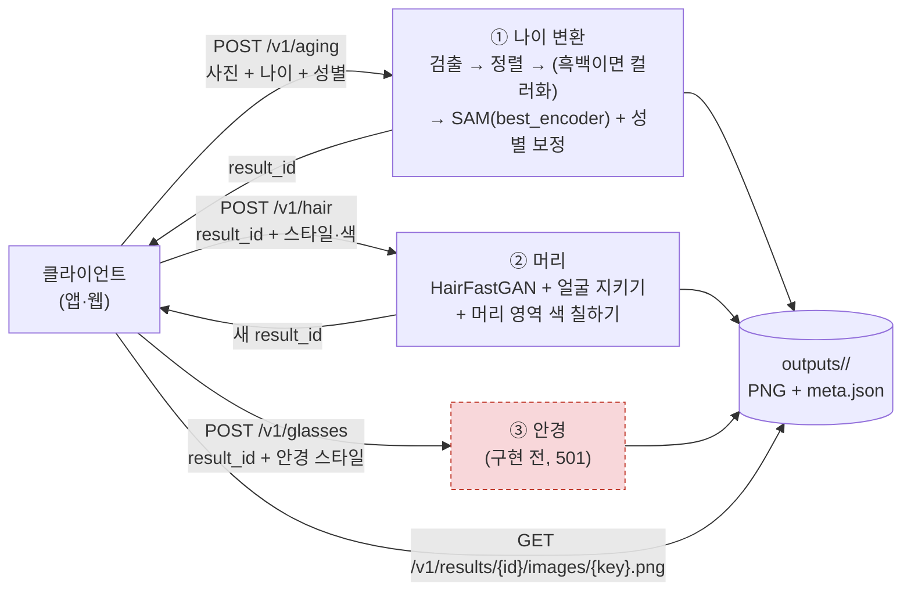

# [00] 서버 구성 계획

> 2026-10-20 작성. `ai_lab` 에서 실험으로 고른 최종 모델을 서비스용 API 서버로 옮긴 구성이다.
> 같은 날 나이 변환을 **SAM + 나이 인코더 전체 튜닝(`best_encoder.pt`)** 으로 바꾸고, 가족 데이터로 학습한 LoRA 두 개(latent 어댑터, 재구성 인코더 LoRA)를 뺐다 (4-1).
> 용어: **FFHQ 정렬** = 눈·입 위치를 기준으로 얼굴을 1024x1024 로 잘라 똑바로 세운 것. 모든 결과 이미지는 이 모양이다.
> **result_id** = 요청 하나가 만든 결과 묶음의 이름. 다음 단계 요청에 넣으면 그 결과 위에 이어서 적용한다.

---

## 1. 목표

| | 내용 |
|---|---|
| 하는 일 | ① 사진 + 나이 → 나이 변환 ② 머리 스타일·색 적용 ③ 안경 씌우기 (③은 명세만, 구현 전) |
| 원칙 | 모델 코드·가중치는 ai_lab 에서 가져온 것을 쓴다. 서버 쪽에서 새로 튜닝하지 않는다 |
| 환경 | 지금과 같은 Windows, Python 3.10, GPU 6GB (RTX 1000 Ada). FastAPI + uvicorn |

---

## 2. 전체 흐름



- 단계마다 **새 result_id** 가 생기고 `parent_id` 로 이전 결과를 가리킨다. 그래서 같은 나이 변환 결과에 머리를 여러 번 바꿔 볼 수 있고, 머리 결과 위에 안경을 얹을 수 있다.
- 머리·안경은 나이 변환 없이 **사진을 바로 올려도** 된다 (서버가 검출·정렬한다).

---

## 3. 폴더 구조

```
ai_server_final/
├─ start_server.bat        Windows 실행 파일 (가상환경을 찾아 python -m app 실행)
├─ .runtime/, .venv/        이 PC의 Python 본체·설치용 임시 파일과 가상환경 (git 제외)
├─ app/                    FastAPI 서버 (이 저장소에서 새로 만든 코드)
│   ├─ main.py             API 경로 (명세는 5장, /docs 에 Swagger 문서, /test/aging·/test/post 에 시험 페이지)
│   ├─ static/             시험 페이지: aging.html (나이 변환), post.html (머리·화장·안경), common.css·common.js
│   ├─ engine.py           모델 실행 + GPU 차례 관리 (ai_lab /final 화면과 같은 순서)
│   ├─ store.py            결과 저장 (outputs/<result_id>/)
│   ├─ schemas.py          응답 형식
│   ├─ settings.py         환경 변수 설정
│   └─ __main__.py         python -m app
├─ src/                    ai_lab/src 에서 복사한 모델 코드 (바꾸지 않음)
├─ configs/
│   ├─ final.yaml          나이 변환 설정 (ai_lab 최종 모델에서 LoRA 빼고 best_encoder)
│   └─ hair_presets.yaml   머리 스타일·색 목록, 참조 선정본 (그대로)
├─ scripts/sync_assets.py  ai_lab 에서 가중치·외부 코드·참조 사진 복사
├─ weights/                ┐
├─ third_party/            ├ git 제외 (sync_assets.py 로 채움)
├─ data/hair_refs/         ┘
└─ outputs/                결과 (git 제외, 24시간 뒤 자동 삭제)
```

`src/` 는 ai_lab 코드 그대로라서, ai_lab 에서 모델을 고치면 그 파일만 다시 복사하면 된다 (화장 `makeup_transfer.py`, 부모 반영 `kinship.py` 는 이번 API 에 없어서 뺐다. `kin_adapter.py` 는 성별 보정이 IR-SE50 을 불러올 때 써서 남겼다).

---

## 4. 가져온 것

### 4-1. 나이 변환 설정 (`configs/final.yaml`)

| 단계 | 쓰는 것 | 가중치 |
|---|---|---|
| 얼굴 검출 | RetinaFace (긴 변 1024 로 줄여서 검출) | `weights/facexlib/detection_Resnet50_Final.pth` |
| 정렬 | FFHQ 1024 | |
| 흑백 컬러화 | CodeFormer 얼굴 컬러화, 색 퍼짐 3.0 미만일 때만 (색만 쓰고 밝기는 원본) | `weights/codeformer/codeformer_colorization.pth` |
| 복원·업스케일 | 끔 (켜면 신원 점수가 떨어짐, ai_lab docs/[27] 3장) | |
| 나이 변환 | SAM (디코더·재구성 인코더는 원본) | `weights/sam/sam_ffhq_aging.pt` |
| 나이 인코더 | **전체 튜닝 가중치로 통째 교체** (`aging.encoder_full`) | `weights/sam/best_encoder.pt` |
| 성별 보정 | 방향 보정 세기 2 + 그림 보고 고치기 (IR-SE50 판정기) | `weights/kin/gender_dir.pt`, `weights/ir_se50/model_ir_se50.pth` |

뺀 것 (가족 데이터로 학습한 LoRA, 2026-10-20 요청으로 삭제)

| 뺀 것 | 가중치 | 하던 일 |
|---|---|---|
| latent 어댑터 v3 (3-A) | `kin_latent_v3.pt` | SAM latent 에 부모 조건 잔차를 더함 (부모 없이도 켜져 있었음) |
| 재구성 인코더 LoRA (3-C) | `recon_lora_true.pt` | 한국인·옛날 사진 인버전 손실 줄이기 |

`best_encoder.pt` 정보
- 받은 파일은 ai_lab 의 `weights/sam/sam_encoder_full_ft.pt` 와 **가중치가 완전히 같다** (621개 텐서 차이 0). 원본 `sam_ffhq_aging.pt` 해시에서 출발해 step 300 까지 학습
- 학습 때 검증 값 (받은 파일의 metrics): 신원 코사인 0.754, 나이 오차 5.8세. 학습 쪽 검증이라 ai_lab dev/test 와 같은 기준이 아니다
- ai_lab `/sam` 화면에서 사진 1장(kid.jpg, 20·40·60세)으로 본 것: 입력 대비 ArcFace 원본 0.443/0.362/0.362 → 튜닝 0.495/0.422/0.408, 대신 60세에서 늙는 정도가 약함. **dev/test 평가는 아직 없다** (ai_lab docs/[05])

성별 보정은 유지 (ai_lab dev 67명: 뒤바뀜 37% → 24% (세기 2) → 21% (그림 보고 고치기까지), docs/[27]·[28]).
주의: 성별 방향(`gender_dir.pt`)은 재구성 LoRA 를 켠 latent 로 구한 것이다. LoRA 를 뺀 지금 조합에서 뒤바뀜 비율은 다시 재지 않았다.

### 4-2. 머리 (`configs/hair_presets.yaml`, `src/hairstyle.py`)

- 모양: HairFastGAN. 원래 머리 지우기 → 참조 사진 배경 지우기 → 같은 스타일 참조 3장 중 **얼굴 폭이 가장 비슷한 것** 자동 고르기 → 얼굴 부위는 입력 그대로 합성 (신원 보호)
- 색: 머리 영역을 Lab 색공간에서 목표 색으로 칠하기 (결·윤기 유지, ΔE 0.1~0.4)
- 참조 사진: 성별·스타일마다 품질 규칙으로 고른 3장 (`selected_refs`). 남 3종(아주 짧은 머리·짧은 머리·덮머), 여 5종(숏컷·단발·앞머리 단발·긴 머리·앞머리 긴 머리), 색 14종

### 4-3. 같은지 확인

같은 사진(`ai_lab/data/samples/kid.jpg`)으로 서버와 ai_lab 코드를 각각 돌려 비교했다.

| | 픽셀 차이 (0~255) |
|---|---|
| 나이 변환 30세 ↔ ai_lab `/sam` 경로 (원본 SAM + 전체 튜닝 인코더, 복원 끔, 성별 보정) | 평균 0.20, 최대 25 (성별 그림 보고 고치기의 bf16 계산 오차 수준) |
| 나이 변환 30세 ↔ 이전 서버 설정 (LoRA + 어댑터) | 평균 26.6, 최대 193 → 새 인코더가 실제로 쓰임 |
| 머리 (짧은 머리 + 애쉬 브라운) | 평균 0, 최대 0 (완전히 같음) |

---

## 5. API 명세

- 모든 요청은 `multipart/form-data` (사진 파일 + 폼 값). 응답은 JSON, 이미지는 URL 로 받는다.
- `API_KEY` 환경 변수를 정하면 모든 `/v1/*` 요청에 `X-API-Key` 헤더가 필요하다.
- 실행 중 `http://<서버>:8000/docs` 에서 모든 명세를 본다. 시험 페이지는 두 개: `/test/aging` 에서 나이 변환을 하고 "후처리로 →" 를 누르면 `/test/post?result_id=...` 로 넘어가 머리 → (화장, 서버 API 없음) → 안경을 이어서 눌러 볼 수 있다. 기본 주소 `/`와 `/test`는 `/test/aging`으로 넘어간다.

### 5-1. 나이 변환 `POST /v1/aging`

| 필드 | 필수 | 설명 |
|---|---|---|
| `image` | O | 어릴 때 얼굴 사진 (jpg/png, 15MB 이하). 얼굴이 여러 개면 가장 큰 얼굴. 흑백이면 자동 컬러화 |
| `ages` | O | 목표 나이. `30` 또는 `20,30,40` (1~100, 최대 5개) |
| `sex` | O | `M` / `F`. 결과가 다른 성별처럼 보이지 않게 보정한다 |
| `strength` | | 나이 변환 강도 0~2 (기본 1). 0은 나이 변화만 끄며 얼굴 재구성·성별 보정은 적용 |
| `gender_strength` | | 성별 보정 세기 0~5 (기본 2, 0 = 끔) |
| `encoder` | | 나이 인코더 파일 이름 (`GET /v1/aging/encoders`). 비우면 `configs/final.yaml` 의 기본(`best_encoder.pt`). 목록에 없는 이름·형식이 틀린 파일은 400 |

- `GET /v1/aging/encoders` → `{"default": "best_encoder.pt", "encoders": ["step500.pt", ...]}`. `encoders` 는 `weights/sam/encoders/*.pt` 파일 이름이다. 파일을 넣고 빼는 데 서버 재시작은 필요 없다 ([03] 맨 위).
- 응답 `extra.encoder` 에 실제로 쓴 인코더 파일 이름이 남는다.

```json
{
  "result_id": "20261020-134315-e00dd3", "kind": "aging", "parent_id": null, "sex": "M", "seconds": 12.0,
  "images": [
    {"key": "age30", "age": 30, "url": "/v1/results/20261020-134315-e00dd3/images/age30.png", "info": {}},
    {"key": "age50", "age": 50, "url": "/v1/results/20261020-134315-e00dd3/images/age50.png", "info": {}}
  ],
  "extra": {"encoder": "best_encoder.pt", "colorized": false, "color_spread": 17.76, "ages": [30, 50], "strength": 1.0, "gender_strength": 2.0,
            "identity": {"age30": {"arcface": 0.449}, "age50": {"arcface": 0.469}}}
}
```

`extra.identity`는 입력 사진과 결과 얼굴의 ArcFace(`weights/arcface/w600k_r50.onnx`, CPU) 코사인 유사도다. 기록만 하고 결과를 걸러내지 않는다. 나이 차이가 크면 원래 낮게 나오므로 기준값은 ai_lab dev 평가 뒤에 정한다. 머리 스타일·색 단계는 얼굴을 원본에서 다시 붙이므로 채점하지 않는다. 위 숫자는 2026-10-22 이 PC에서 성인 얼굴 사진 1장으로 잰 값이다 (아이 사진 아님, dev/test 평가 아님).

시험 페이지에서 나이 변환 강도를 0.1씩 조절한다. 기존 모델의 `aging.params.strength`로 전달하며 `src/`와 기본 모델 설정은 바꾸지 않는다. 강도는 응답의 `extra.strength`와 저장된 결과 정보에 기록한다. 범위를 벗어나거나 유한한 수가 아닌 값은 422로 거절한다.

### 5-2. 머리 스타일 `POST /v1/hair`

입력은 `result_id` 또는 `image` 중 하나.

| 필드 | 필수 | 설명 |
|---|---|---|
| `result_id` | △ | 이전 결과 (나이 변환 결과 등). 그 결과의 이미지 전부에 적용 |
| `keys` | | `result_id` 이미지 중 일부만 (`age30,age40`) |
| `image` | △ | 얼굴 사진 (나이 변환 없이 바로). 이때는 `sex` 필수 |
| `sex` | | `M`/`F`. `result_id` 면 그 결과의 성별을 쓴다 |
| `style` | ※ | 스타일 key (`GET /v1/hair/styles`). 비우면 색만 바꾼다 |
| `ref` | | 참조 사진 이름 또는 `auto` (기본, 얼굴 폭이 가장 비슷한 참조 자동) |
| `color` | ※ | 색 key (`ash_brown`) 또는 `#RRGGBB`. 비우면 참조 사진의 색 |
| `scale` | | 머리 크기 배율 0.8~1.25 (기본 1) |

※ `style` 과 `color` 중 하나는 있어야 한다. 응답 형식은 5-1 과 같고 `info` 에 쓴 참조(`ref`), 배율(`scale`), 목표 색과의 차이(`color_dE`) 가 들어간다.

보조 API
- `GET /v1/hair/styles` → `{styles: {M: [{key, name, desc, refs}], F: [...]}, colors: [{key, name, hex}]}`
- `GET /v1/hair/styles/{sex}/{key}/{ref}/thumbnail` → 참조 사진 썸네일 JPG (참조 속 얼굴은 지우고 머리만 보임. AI Hub 사진이라 얼굴을 내보내지 않는다)

### 5-3. 안경 `POST /v1/glasses` (구현 전)

지금은 요청을 검사한 뒤 **501** 을 돌려준다. 클라이언트는 이 형식에 맞춰 미리 붙여 둘 수 있다.

| 필드 | 필수 | 설명 |
|---|---|---|
| `result_id` | △ | 이전 결과 (머리 결과 등) |
| `keys` | | 일부 이미지만 |
| `image` | △ | 얼굴 사진. 이때 `sex` 필수 |
| `sex` | | `M`/`F` |
| `style` | O | 안경 스타일 key (`GET /v1/glasses/styles`, 지금은 빈 목록과 `implemented: false`) |

응답은 구현 후 5-1 과 같은 형식 (`kind: "glasses"`).

### 5-4. 공통

| API | 설명 |
|---|---|
| `GET /v1/results/{result_id}` | 결과 정보 (`meta.json` + 이미지 URL) |
| `GET /v1/results/{result_id}/images/{key}.png` | 결과 이미지 PNG (1024, 무손실) |
| `GET /health` | `{status, cuda, gpu, busy(지금 작업 중), loaded(GPU 에 올라간 모델)}` |

| 오류 코드 | 언제 |
|---|---|
| 400 | 값이 잘못됨, 사진에서 얼굴을 못 찾음, 없는 스타일·색 |
| 401 | `X-API-Key` 가 틀림 (`API_KEY` 를 정했을 때만) |
| 404 | 없는 result_id·이미지 (24시간 지나 지워졌을 수 있음) |
| 501 | 안경 (구현 전) |
| 503 | GPU 를 기다리다 `QUEUE_TIMEOUT`(기본 300초) 초과 |

### 5-5. DB 원본 작업 `/v1/workbench/*` (로컬 전용)

실종아동 DB 원본으로 변환하고 고른 결과만 DB 에 저장한다. 이 서버는 DB 를 직접 다루지 않고 Java 백엔드(`JAVA_API_URL`)만 부른다 (`app/java_client.py`).

| API | 설명 | Java 쪽 |
|---|---|---|
| `GET /persons?page=&size=` | 실종아동 목록 (페이지) | `GET /api/missing-persons` |
| `GET /persons/{id}` | 상세 + 원본 사진 목록 | `GET /api/missing-persons/{id}` |
| `GET /persons/{id}/images/{imageId}` | 원본 사진 (화면 표시용, 저장 안 함) | `GET /api/missing-persons/{id}/images/{imageId}` |
| `POST /aging` | `person_id`, `source_image_id` + `/v1/aging` 과 같은 옵션 → 결과 `meta.json` 에 `origin` 기록 | 원본 조회 |
| `POST /saves` | `result_id`, `key` → 그 이미지를 DB 에 저장. 201 새로 저장, 200 이미 저장됨, 409 같은 번호로 다른 사진 | `POST /api/local/aiworkbench/saves` |
| `GET /saves?result_id=` 또는 `?person_id=` | 저장 이력 | `GET /api/local/aiworkbench/saves` |
| `GET /ai-images/{id}` | DB 에 저장한 사진 | `GET /api/local/aiworkbench/ai-images/{id}` |

- `origin` = `{person_id, source_image_id, person_name, model}`. 머리·안경을 이어서 만들면 부모의 `origin` 을 물려받는다. `origin` 이 있는 결과의 `ageNN` 이미지만 저장할 수 있다 (업로드로 만든 결과는 400).
- 저장할 때 목표 나이는 이미지 키(`age30`)에서, 생성 옵션은 처음 단계부터의 `meta.json` 옵션 묶음(`steps`)으로 보낸다.
- 요청 제한: 클라이언트가 루프백이 아니면 403, `Origin` 이 이 서버 주소가 아니면 403. Java 저장 API 도 이 PC 의 서버 간 요청만 받는다.
- Java 가 꺼져 있거나 저장 기능을 켜지 않았으면 502.

---

## 6. GPU 와 동시 요청

6GB 하나라서 ai_lab 과 같은 방식을 쓴다.

- **한 번에 한 요청만** GPU 를 쓴다. 나머지 요청은 줄을 서서 기다린다 (최대 300초, 넘으면 503). uvicorn worker 도 1개로 고정.
- 나이 변환(SAM 2.3GB + 부속)과 머리(HairFastGAN 약 5.5GB)는 **같이 올라가지 않는다.**
  - 나이 변환 요청이 오면 머리 모델을 내린다.
  - 머리 모델은 다음 나이 변환 전까지 올려 둔다. 스타일만 바꿔 다시 요청할 때 다시 올리는 시간(약 17초)을 아끼려고.
- 나이 변환은 `final.yaml` 의 `keep_loaded: false` 를 따라 단계마다 올렸다 내린다.

측정 (이 노트북, 사진 1장, 2026-10-20):

| 요청 | 시간 |
|---|---|
| 나이 변환, 나이 2개 (LoRA 조합 / best_encoder 조합) | 12.0초 / 13.0초 |
| 머리 (모델 처음 올림 + 스타일 + 색), 1장 | 58.2초, 81.8초 (두 번 잼) |
| 머리 (올린 사진 정렬 + 스타일), 1장 | 56.5초 |

머리는 1장에 1분 가까이 걸리므로, 나이 3개에 모두 머리를 입히면 2~3분이 걸릴 수 있다 (7장 2번).

---

## 7. 보안·개인정보·라이선스

- **얼굴 사진**: 올린 사진과 결과는 `outputs/` 에만 두고 `RESULT_TTL_HOURS`(기본 24시간) 뒤 지운다. git 에 올리지 않는다.
- **참조 사진**(`data/hair_refs/`)은 AI Hub 데이터라 재배포 금지. 서버는 썸네일도 얼굴을 지운 것만 내보낸다. 실제 서비스에 쓰려면 AI Hub 이용 조건을 다시 확인해야 한다.
- **라이선스**: CodeFormer(컬러화)는 S-Lab 비상업 라이선스, SAM·HairFastGAN 은 각 저장소 라이선스를 따른다. 지금은 학교 연구 과제 범위에서만 쓴다.
- 외부에 열 때는 `API_KEY` 를 정하고 `CORS_ORIGINS` 를 클라이언트 주소로 좁힌다. `HOST=0.0.0.0` 은 그때만.

---

## 8. 다음 할 일

1. **안경 구현**: 후보를 비교해 고른다.
   - 2D 안경 이미지를 눈 랜드마크에 맞춰 합성: 가볍고 빠름, 모양을 정확히 고를 수 있음. 조명·그림자가 어색할 수 있음
   - StyleGAN latent 편집 (안경 방향으로 latent 이동): 지금 SAM latent 와 바로 붙음. 안경 모양을 고르기 어렵고 신원이 바뀔 수 있음
   - 디퓨전 인페인팅: 자연스럽지만 6GB 에서 느림
   - 어느 것이든 ai_lab 처럼 ArcFace·AdaFace 로 "안경 전후 같은 사람인가"를 재서 고른다 (학습용 IR-SE50 과 섞지 않기)
2. **오래 걸리는 머리 요청**: 지금은 끝날 때까지 응답을 기다린다. 클라이언트 시간 제한에 걸리면 "작업 등록 → 상태 조회" 방식(`POST` 는 job_id 만 돌려주고 `GET /v1/jobs/{id}` 로 확인)으로 바꾼다.
3. **best_encoder 조합 평가**: ai_lab 에서 dev 67명으로 신원(ArcFace·AdaFace)·나이·성별 뒤바뀜을 재서, 뺀 LoRA 조합보다 나쁘지 않은지 확인한다. 부모 사진 반영은 어댑터를 빼서 이제 지원하지 않는다.
4. 다른 서버로 옮길 때: 리눅스면 `patch_third_party.py` 없이 원래 CUDA 연산을 쓸 수 있고, Docker 로 묶는다.
