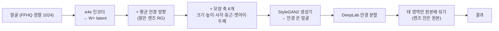

# [05] 안경 GlassesGAN 적용 계획

> 2026-10-27 작성. 계획만 있고 아직 구현·측정하지 않았다. 아래 숫자 중 시간·점수는 **없다**.
> 지금 방식(안경 사진 2D 합성, docs/[04])은 동작하지만 "붙인 것 같다"는 체감이 있어서, **안경을 실제로 쓴 것 같은 자연스러움**을 목표로 방법을 바꾼다.

---

## 0. 요약

| | 내용 |
|---|---|
| 주 방법 | **GlassesGAN** (CVPR 2023, MIT). 얼굴을 StyleGAN2 latent 로 바꾼 뒤 "안경 방향"을 더해 생성기가 안경을 직접 그리게 하고, **테 영역만** 원본에 섞는다 |
| 왜 | 조명·반사·그림자·코받침 가림을 생성기가 함께 그려서 2D 합성보다 자연스럽다. 렌즈 안(눈)은 원본 그대로라 신원 위험이 작다 |
| 안경 종류 | 필수 2개 **검정 뿔테**, **검정 동글이** + 무채색 3개 (검정 얇은 사각, 진회색 메탈 라운드, 은색 얇은 사각). 색이 강한 안경은 넣지 않는다 |
| 모양 정하기 | GlassesGAN 의 6개 모양 축(크기·높이·사각·둥근·캣아이·두께) 값을 안경마다 프리셋으로 정한다 |
| 색 정하기 | 생성된 테 색을 Lab 에서 검정·진회색·은색으로 고정 (머리 색 칠하기와 같은 원리) |
| 대비책 | Windows 설치나 품질이 막히면 **지금 2D 합성 + 테 띠만 디퓨전으로 다듬기**(2-C)로 간다. 지금 방식은 비교용으로 남긴다 |

---

## 1. GlassesGAN 이 하는 일 (저장소 확인 결과)

저장소: <https://github.com/pleshro/GlassesGAN_release> (MIT, 2026-10 에도 갱신됨). 데모 노트북 `Glasses_Try_on_App_demo_V2.ipynb` 와 `glasses_vton_inference.py` 를 읽고 정리했다.



| 받을 파일 (Google Drive, 노트북 기준) | 하는 일 |
|---|---|
| `e4e_ffhq_encode.pt` | e4e 인코더 + StyleGAN2(FFHQ 1024) 생성기 |
| `aveglassesdiff_celebhq_dataset_results_RG.npy` | 평균 안경 방향 (맑은 렌즈). `_SG` 는 선글라스라 안 씀 |
| `fitted_pca_celebhq_dataset_results.joblib` | 모양 축 (PCA) |
| `deeplab_epoch_19.pth` | 안경 분할 (섞을 테 영역) |

- 섞기: `use_full_glasses_or_frames_mask='frames'` 이면 **테만** 생성 결과를 쓰고 렌즈 안은 입력 사진 그대로. 경계는 넓히고 흐리게 섞는다 (`outer_dilation 5, outer_blur 12, inner_blur 5`).
- 노트북 기본 모양 값: 크기 6, 높이 -9, 사각 8, 둥근 0, 캣아이 1.5, 두께 6.5 (부호를 일부 뒤집어 씀). 우리 프리셋의 출발점으로 쓴다.
- 얼굴 정렬은 dlib 으로 하지만 우리 입력은 이미 FFHQ 정렬이라 **정렬 단계는 건너뛴다** (dlib 설치 불필요).

---

## 2. 후보 비교

| | A. 지금: 안경 사진 2D 합성 | **B. GlassesGAN (주 방법)** | C. 2D 합성 + 테 띠 디퓨전 다듬기 | D. 디퓨전 글 인페인팅 |
|---|---|---|---|---|
| 방식 | 사진을 눈에 맞춰 얹음 | 생성기가 안경을 그리고 테만 섞음 | A 결과의 테·그림자 띠만 ControlNet 인페인팅으로 다시 그림 (눈 제외) | 눈 주변을 지우고 글로 안경 그림 |
| 자연스러움 | △ 붙인 느낌 | ◎ 조명·그림자·코받침이 함께 생김 | ○~◎ | ◎ |
| 모양 맞추기 | ◎ 사진 그대로 | ○ 6개 축으로 비슷하게 (카탈로그와 똑같지는 않음) | ◎ | △ |
| 색 (검정 등) | ◎ | ○ Lab 으로 고정 | ◎ | △ |
| 원본(눈) 유지 | ◎ | ◎ 렌즈 안은 원본 | ◎ 눈 마스크 제외 | ✕ 눈을 다시 그림 |
| 6GB GPU | ◎ 안 씀 | ○ e4e + StyleGAN2, 나이·머리 모델 내린 뒤 | △ SD 계열, 미확인 | △ 미확인 |
| 같은 요청 → 같은 결과 | ◎ | ◎ | △ 시드 고정 필요 | ✕ |
| 설치 위험 | 없음 | StyleGAN2 CUDA 연산(Windows), 옛 sklearn PCA 파일 | SD 가중치 수 GB | SD 가중치 |

◎ 좋음 ○ 괜찮음 △ 약함 ✕ 안 맞음. 문서·코드를 보고 매긴 것이며 잰 비교가 아니다.

**결정**: B 를 먼저 붙인다. 화면에서 A·B 를 나란히 비교해 B 가 낫다고 보이면 기본값으로 바꾼다. B 가 설치·품질에서 막히면 C 를 시험한다. D 는 눈을 다시 그려서 쓰지 않는다.

---

## 3. 안경 목록 (무채색만)

| key | 이름 | 필수 | GlassesGAN 모양 (시작값, 화면에서 조정) | 테 색 (Lab 고정) |
|---|---|---|---|---|
| `horn_black` | 검정 뿔테 | **필수** | 사각 높게, 두께 높게 (노트북 기본값 근처) | 검정 |
| `round_black` | 검정 동글이 | **필수** | 사각 낮게(음수), 둥근 높게, 캣아이 0, 두께 중간 | 검정 |
| `rect_thin_black` | 검정 얇은 사각테 | 추가 | 사각 중간, 두께 낮게(음수) | 검정 |
| `round_gunmetal` | 진회색 메탈 라운드 | 추가 | 동글이와 같고 두께 더 낮게 | 진회색 |
| `rect_thin_silver` | 은색 얇은 사각테 | 추가 | 얇은 사각과 같음 | 은색 (밝은 회색) |

- 모양 값은 `configs/glasses_presets.yaml` 에 둔다. 사진 여러 장에서 같은 값이 비슷한 안경을 만드는지 보고 정한다.
- 색 고정: DeepLab 테 마스크 안에서 a·b 를 0 쪽으로, 밝기(L)는 목표 평균에 맞추되 원래 명암(하이라이트·그림자)은 남긴다.
- 원래 2D 합성 에셋(`thin_round`, `horn_black` 사진)은 A 방식 비교용으로 남긴다. 기존 `thin_round`(금색)는 목록에서 뺀다 (색이 있음).

---

## 4. 서버에 붙이는 방법

### 4-1. 흐름과 GPU

```
입력(정렬 얼굴) ─▶ e4e 인코딩 (latent 를 outputs/<id>/ 에 저장해 다시 쓸 때 건너뜀)
              ─▶ latent + 평균 안경 + 모양 축 ─▶ StyleGAN2 생성
              ─▶ DeepLab 테 분할 ─▶ 테 색 고정 ─▶ 테만 원본에 섞기 ─▶ 원본 유지 확인
```

- 머리 단계와 같이 **나이 변환·HairFastGAN 을 내린 뒤** 올린다 (AGENTS.md 2장, `engine.gpu()` 차례). 메모리는 실제로 재서 [00] 6장에 적는다.
- **latent 재사용**: 같은 결과에 안경만 바꿔 누를 때 인코딩을 다시 하지 않게 `outputs/<result_id>/<key>.latent.npy` 로 저장한다 (24시간 뒤 같이 지워짐).
- (확인 필요) SAM 의 생성기와 e4e 의 생성기가 같은 FFHQ StyleGAN2 가중치면, 나이 변환 결과는 **SAM 이 만든 latent 를 바로** 쓸 수 있다 (인코딩 손실 없음). 해시로 확인한 뒤 결정한다.
- 원본 유지: 지금처럼 "섞은 마스크 밖 픽셀은 입력 그대로 복사"를 마지막에 한 번 더 강제한다.

### 4-2. 설치 (Windows)

| 할 일 | 방법 |
|---|---|
| 코드 | `third_party/GlassesGAN/` 에 클론 (git 제외, 다른 외부 코드와 같음) |
| 가중치 4개 | `scripts/download_assets.py` 에 Google Drive id 추가 → `weights/glassesgan/` |
| StyleGAN2 CUDA 연산 | SAM 에 쓰는 `scripts/patch_third_party.py` 방식을 그대로 적용 (같은 rosinality 코드) |
| dlib | 안 씀 (정렬 건너뜀) |
| PCA joblib | 지금 sklearn 버전으로 안 열리면, 한 번 열어서 `components_`·`mean_` 을 `.npz` 로 바꿔 저장해 쓴다 |
| 실행 코드 | 노트북·`glasses_vton_inference.py` 는 Colab 용이라 그대로 쓰지 않고, 필요한 부분(인코딩·방향 더하기·생성·분할·섞기)만 `src/glasses_gan.py` 로 옮긴다 |

### 4-3. API (기존 `POST /v1/glasses` 확장)

| 필드 | 설명 |
|---|---|
| `style` | 3장 목록의 key |
| `method` | `gan`(GlassesGAN) / `overlay`(지금 2D 합성). 비교가 끝나기 전 기본은 `gan` |
| `size`, `thickness` | 선택. 프리셋에 더하는 미세 조정 -1~1 (모양 축 크기·두께) |
| `scale` | `overlay` 에서만 (지금 그대로) |

- `info`: `method`, `latent_cached`(인코딩을 건너뛰었나), `frame_area`(테 면적 비율), `changed_ratio`. `extra.identity` = 안경 전 대비 ArcFace (참고만, 평가용과 학습용 망을 섞지 않음).
- `GET /v1/glasses/styles` 는 `methods`(쓸 수 있는 방식)를 같이 준다. GlassesGAN 가중치가 없으면 `gan` 이 빠지고 요청 시 400.

### 4-4. 고칠 파일

| 파일 | 할 일 |
|---|---|
| `src/glasses_gan.py` (새로) | e4e 인코딩, 안경 방향·모양 축, 생성, DeepLab 분할, 테 색 고정, 섞기 |
| `configs/glasses_presets.yaml` (새로) | 안경 5종 모양 값·색 |
| `app/engine.py` | `glasses(method=...)`, GPU 차례·모델 내리기, latent 캐시 |
| `app/main.py`, `app/schemas.py` | `method`·`size`·`thickness`, 목록에 `methods` |
| `app/static/post.html` | 4-5 |
| `scripts/download_assets.py`, `scripts/patch_third_party.py`, `scripts/check_setup.py` | 가중치·패치·점검 |

### 4-5. 시험 페이지 (`/test/post` 안경 칸)

- 안경 카드 5장 (필수 2장이 앞).
- **방식 고르기**: GlassesGAN / 사진 합성 / **둘 다 비교**.
- "전부 씌우기": 원본 + 안경 5종을 한 줄로. "둘 다 비교"면 같은 안경을 방식별로 위아래로.
- 크기·두께 슬라이더 (GlassesGAN 일 때만).
- 각 칸 아래 ArcFace(안경 전 대비), 바뀐 픽셀, 걸린 시간.

---

## 5. 확인 계획

| 무엇 | 어떻게 |
|---|---|
| 자연스러움 | 같은 얼굴에 A·B(·C) 결과를 이름 가리고 섞어서 팀원이 "더 자연스러운 것" 고르기. 사진 6장 이상 (kid 30·50세, iu, 남녀 성인, 머리가 귀 덮은 얼굴) |
| 원본 유지 | 섞은 마스크 밖 바뀐 픽셀 0, 렌즈 안(눈) 바뀐 픽셀 0 |
| 신원 | 안경 전 대비 ArcFace (방식별·안경별 평균) |
| 모양 | 같은 프리셋이 얼굴마다 "뿔테", "동글이"로 보이는지 |
| 색 | 테 평균 Lab 이 목표(검정·진회색·은색)에 가까운지 |
| 속도·메모리 | 처음(모델 올림) / 이어서 / latent 캐시 있을 때, 최대 GPU 메모리 |

잰 값은 날짜·사진 수·dev/test 아님을 밝혀 [00]·[01] 에 적는다. 통과선은 첫 측정 뒤 정한다.

---

## 6. 진행 순서

| 순서 | 할 일 | 끝 기준 | 막히면 |
|---|---|---|---|
| 1 | 클론·가중치·CUDA 패치, 사진 1장으로 노트북 기본값 재현 | 안경 쓴 결과 1장, 시간·메모리 기록 | CUDA 연산 → 순수 PyTorch 대체 연산 / PCA → npz 변환 |
| 2 | 테만 섞기 + 원본 유지 강제 + 테 색 고정 | 렌즈 안·마스크 밖 바뀐 픽셀 0 | |
| 3 | 안경 5종 프리셋 정하기 | 사진 6장에서 모양이 일관됨 | 둥근 테가 안 나오면 동글이만 C 방식 |
| 4 | 엔진·API·latent 캐시 | `method=gan` 200, 가중치 없으면 400 | |
| 5 | 시험 페이지 방식 비교 | 브라우저에서 A·B 나란히 | |
| 6 | 블라인드 비교·측정, 기본 방식 결정, 문서 | [00]·[01]·README 갱신 | B 가 지면 C 시험 |

---

## 7. 주의할 점

- **라이선스**: GlassesGAN 코드는 MIT. 생성기는 NVIDIA FFHQ StyleGAN2(비상업)로 SAM 과 같은 조건이고, 안경 방향·PCA 는 CelebA-HQ 에서 만들어졌다 (연구용). 지금처럼 학교 연구 과제 범위에서만 쓴다 ([00] 7장).
- **e4e 재구성 차이**: 생성된 얼굴은 입력과 조금 다르다. 테 영역만 섞으므로 영향은 테 주변 몇 픽셀이지만, 눈썹·눈꼬리에 겹치는 곳은 꼭 눈으로 확인한다.
- **이미 안경 쓴 얼굴**: 안경을 하나 더 그릴 수 있다. BiSeNet 안경 라벨로 미리 알리고(`had_glasses`) 요청은 받는다.
- **아이·노인 얼굴**: 방향은 CelebA-HQ(성인)에서 구했다. 나이 변환 결과(30·50세)는 괜찮을 가능성이 높지만, 아이 원본에 바로 씌우는 경우는 따로 본다.

---

## 8. 진행 결과

### 8-1. 1단계: 이 PC 에서 돌려 보기 (2026-10-27)

**준비**
- 코드: `third_party/GlassesGAN` (커밋 `8924f99`, 2026-10-11). 가중치 4개 → `weights/glassesgan/` (e4e 1.2GB, DeepLab 235MB, PCA 1.5MB, 평균 안경 37KB). `scripts/download_assets.py` 에 Google Drive id 를 넣어 다시 받을 수 있게 함
- StyleGAN2 CUDA 연산: `scripts/patch_third_party.py` 에 GlassesGAN 경로를 더해 SAM 과 같은 순수 PyTorch 연산으로 바꿈 → Windows 에서 그대로 돎
- PCA joblib: 지금 sklearn 1.7.2 로 그대로 열림 (축 20개 × 18×512). `.npz` 변환 필요 없음
- **e4e 생성기 = SAM 생성기**: 두 체크포인트의 decoder 텐서 171개가 모두 똑같다 → 나이 변환 결과는 SAM latent 를 바로 쓸 수 있다 (4단계에서 적용)
- 원본 코드는 Colab 용이라 쓰지 않았다: e4e 래퍼는 체크포인트를 복사하고 wget 으로 dlib 파일을 받고, DeepLab 래퍼는 임시 파일을 쓰고 다른 스크립트를 실행하며 `input()` 으로 묻는다. 대신 모델(`pSp`, `deeplabv3_resnet101` 4부위)만 직접 불러 같은 순서로 돌렸다 (dlib 정렬은 건너뜀)

**돌린 것**: 노트북 흐름 그대로. e4e 인코딩 → 평균 안경 세기 자동 고르기(0.5~1.5 를 20번 생성해 테 면적 0.020 에 가장 가까운 것) → 노트북 기본 모양 값 → 테만 섞기

**잰 값** (이 PC RTX 1000 Ada 6GB, 사진 3장: kid.jpg 30·50세 나이 변환 결과, iu.png 정렬본. dev/test 아님)

| | 값 |
|---|---|
| 모델 올리기 | 5.1초, GPU 1.34GB |
| 인코딩 + 재구성 | 처음 1.42초, 이어서 0.14초 |
| 안경 세기 자동 고르기 (생성·분할 20번) | 3.6~4.3초 ← 가장 느림 |
| 모양 바꾸고 생성·분할·섞기 | 0.9~1.0초 |
| 최대 GPU 메모리 | 1.85GB |
| 바뀐 픽셀 | 11~12% (테 마스크를 넓히고 흐려서 섞기 때문) |

**눈으로 본 것**
- 평균 안경만 더해도 **검정 동글이**에 가까운 안경이 나오고, 노트북 기본 모양 값은 **검정 뿔테(큰 웰링턴)**에 가깝다. 필수 2종의 출발점으로 바로 쓸 수 있다
- 테에 하이라이트·두께감·코받침이 같이 생겨 2D 합성보다 "쓴" 느낌이 난다
- 생성 그대로의 얼굴은 눈매가 바뀌지만, 테만 섞은 결과는 눈·피부가 원본 그대로다
- 렌즈 안 픽셀도 21~23% 바뀌었다: 테 마스크 안쪽 흐림이 렌즈 가장자리까지 들어간 것. 눈동자 쪽은 그대로였지만 2단계에서 렌즈 가장자리 섞기 폭을 줄이고 "섞기 마스크 밖은 원본 그대로"를 강제한다

**2단계로 넘길 것**
- 세기 자동 고르기를 줄이기 (20번 → 이분 탐색 5~6번, 또는 안경 종류마다 세기를 고정)
- 렌즈 가장자리 섞기 폭, 마스크 밖 원본 강제
- 테 색 고정 (검정·진회색·은색)

### 8-2. 2~6단계 (2026-10-27)

**2단계: 섞기·원본 유지·색**
- 테 마스크: 원본 taper 그대로(넓히기 5, 흐리기 12) + 렌즈 안쪽 흐림 5 → 2
- 원본 유지: 렌즈 안에서 **테로부터 10px 넘게 떨어진 곳**과 섞기 마스크 밖은 입력을 그대로 복사. 처음엔 렌즈 마스크를 칼같이 잘랐는데 DeepLab 이 가는 테 일부를 렌즈로 봐서 테가 끊겼다 → 거리 기준으로 바꿈
- 색: 테는 채도(a·b)를 프리셋 배율로 줄이고 밝기 평균만 옮김 (명암은 남김). 테가 아닌 섞인 곳은 **밝기만 생성 결과, 색은 원본**. 테 안 밝은 띠(렌즈 테두리 비침)는 회색이면 피부 옆에서 푸르게 보여서 밝을수록 원본 피부색을 쓴다
- 은색은 뺐다: 밝은 색으로 칠하면 만화처럼 납작해졌다
- 세기 고르기: 20번 → 5번 (1.0~2.0). 사진 3장 모두 1.5~1.75 를 골랐다

**3단계: 프리셋** (`configs/glasses_presets.yaml`): 사진 1장에서 모양 축 6개를 -10~10 으로 그려 보고 고름. size+ = 가늘고 넓은 사각, square- = 가는 금속 라운드, square+ = 각진 웰링턴, thick± = 테 두께

| key | 이름 | 모양 | 색 |
|---|---|---|---|
| `horn_black` ★ | 검정 뿔테 | square 8, thick 6, size -2 | 무채색, 밝기 10 |
| `round_black` ★ | 검정 동글이 | height 3, square -3 | 무채색, 밝기 10 |
| `rect_thin_black` | 검정 얇은 사각테 | size 10, thick -3 | 무채색, 밝기 12 |
| `round_metal` | 진회색 메탈 라운드 | square -10, thick -5 | 채도 0.15 (생성된 금속 밝기 그대로) |

**4단계: 엔진·API** — `Engine.glasses(method=gan|overlay)`, GlassesGAN 은 머리처럼 다른 모델을 내린 뒤 올리고 다음 나이 변환·머리·복원 때 내림. SAM 과 패키지 이름(models 등)이 겹쳐 불러올 때만 바꿔 끼움 (`_isolated`). 미리보기는 생성기 평균 얼굴(실존 인물 아님)에 씌워 만든다.
- **latent 재사용은 하지 않았다**: e4e 인코딩이 0.14초라 저장해서 아낄 시간이 거의 없다. SAM latent 직접 쓰기도 같은 이유로 보류 (생성기가 같은 건 확인해 둠)

**5단계: 시험 페이지** — 방식 고르기, 안경 카드 4장(★ 필수), 크기·두께 슬라이더, 전부 씌우기, 두 방식 비교

**6단계: 확인** (8001 서버, kid.jpg → 30·50세. 잰 값 표는 [00] 5-3)
- 4종 모두 200, 렌즈 안 바뀐 픽셀 0, 잘못된 style·method 400, size 3 → 422
- 안경 뒤 `/health` `loaded: [glasses]`, 이어서 나이 변환 13.9초 정상, `loaded: []`
- `check_workbench` 11개 통과, `check_setup` 준비 완료 (GlassesGAN 은 없으면 경고만)
- 화면: 헤드리스 Chrome 으로 안경 칸(방식·카드 4장·슬라이더) 그려짐 확인. **버튼은 눌러 보지 않았다**

**남은 일**
- 팀원 블라인드 비교 (5장): GlassesGAN 과 사진 합성 중 기본 방식 확정. 지금 기본은 GlassesGAN
- 사진을 더 모아 (남녀·아이 원본·머리가 눈썹 덮은 얼굴) 프리셋이 일관된지 보기

### 8-3. 테 찌그러짐·끝 흐림 보완, 진회색 메탈 라운드 다시 정함 (2026-10-27)

사용자 의견: 안경이 찌그러지거나 끝부분이 흐려진다, 진회색 메탈 라운드는 안경 모양이 아니다.

**원인 (사진 3장을 확대해 확인)**
1. 테 끝 흐림: 테 마스크를 넓히고 크게 흐려(12px) 섞어서 테 끝·다리가 반투명하게 번졌다
2. 아래 테 끊김: DeepLab 이 밝은 얼굴(iu)에서 아래 테 가운데를 **렌즈**로 분류했다. 그 위에 "렌즈 안은 원본" 규칙이 테를 지웠다. 가는 테는 점 지우기(열림 연산)에도 지워졌다
3. 메탈 라운드 팔각형: 모양 값 square -10 이 너무 컸다 (±8 넘으면 찌그러지거나 끊김)

**바꾼 것** (`src/glasses_gan.py` `composite`)
- 같은 latent 로 **안경 없는 얼굴(recon)도 생성**해서 비교한다
- 테 = DeepLab 테 + 놓친 테. 놓친 테는 DeepLab 테와 이어진 것만:
  - 렌즈 밖: DeepLab 테에서 4px 안, recon 보다 밝기 45 넘게 어둡고 0.6배 아래 (넓히면 눈썹이 칠해졌다)
  - 렌즈 안: 가장자리 10px 는 같은 기준, 16px 까지는 가는 어두운 선(black-hat > 20)이면서 recon 에 없던 것 (머리 그늘 덩어리·눈 선은 빠지고 금속 테는 잡힘)
- 테는 경계 1px 만 흐려서 또렷하게 붙인다
- 테 둘레 그림자: 픽셀을 섞지 않고 밝기 비율(edit/recon, 0.82~1.03)만 테에서 5px 안 원본 피부에 곱한다. 렌즈 안은 안 함
- 테 안의 밝은 띠(렌즈 단면 비침)는 색만 원본 피부색
- 시도했다가 뺀 것: 밝은 띠를 테에서 지우기(아래 테가 끊김), 검정 테 명암 0.4배(광택이 사라지고 안쪽이 거칠어짐)

**프리셋** (사진 2장 × 후보 4개 비교, `configs/glasses_presets.yaml`)

| key | 전 | 후 |
|---|---|---|
| 검정 뿔테 | square 8, thick 6, size -2 | square 5, thick 4 |
| 검정 동글이 | height 3, square -3 | square -4, round 3 |
| 검정 얇은 사각테 | size 10, thick -3 | size 7, square 2 |
| 진회색 메탈 라운드 | square -10, thick -5 (팔각형) | square -6, thick -4 (둥근 테) |

**확인** (8000 서버, kid.jpg → 30·50세. 표는 [00] 5-3)
- 4종 200, 렌즈 가운데 바뀐 픽셀 0, 바뀐 픽셀 10~12.5% → 5.8~7.3%, 안경 전 대비 ArcFace 0.81~0.83 → 0.82~0.89
- 사진 3장(kid 30·50세, iu) × 4종 확대 확인: 테 끝 또렷, 아래 테 이어짐. **남은 것**: 일부 사진에서 렌즈 안 위쪽 가장자리에 작은 어두운 자국, iu 메탈 라운드 아래 테 작은 틈
- 미리보기(생성기 평균 얼굴)는 다시 만듦 (눈썹이 테로 칠해지던 것 고침)
- 시험 페이지를 Chrome 으로 눌러 봄: 한 장 4.3초, 전부 씌우기 17.8초, 두 방식 비교 24.3초, JS 오류 없음. check_workbench 11개 통과
